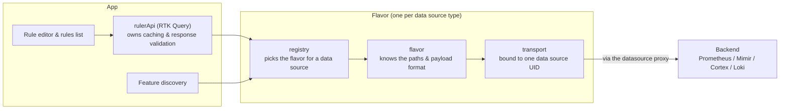

# 1. Rules-source flavors

- Status: accepted
- Date: 2026-08-12

## Context

The plugin reads and writes alert rules for several Prometheus-compatible backends. They are not
interchangeable:

| Backend                               | Plugin type                           | Rules read                | Rules write                                         |
| ------------------------------------- | ------------------------------------- | ------------------------- | --------------------------------------------------- |
| Prometheus                            | `prometheus`                          | `api/v1/rules`            | none                                                |
| Mimir / Cortex                        | `prometheus`                          | `api/v1/rules`            | Cortex ruler config API, `config/v1/rules`, YAML    |
| Loki                                  | `loki`                                | `prometheus/api/v1/rules` | Loki ruler API, `api/prom/rules`, YAML              |
| Amazon Managed Service for Prometheus | `grafana-amazonprometheus-datasource` | `api/v1/rules`            | AMP control plane, JSON envelope around base64 YAML |

Before this decision, that variation lived in four hardcoded allow-lists that disagreed with each
other, three `switch (application)` path helpers, and inline `type === 'loki'` ternaries at roughly
twenty call sites. Adding Loki touched thirty files, most of them under `src/features/rules/**`.
That cost is paid again by every new backend, and it is paid in code that has nothing to do with
the backend being added — which is the real problem, because we expect the AMP implementation to be
contributed by AWS rather than by `@grafana/alerting-frontend`.

We are willing to duplicate code between backends. We are not willing to let a new backend reach
into the parts of the app that make the existing ones work.

## Decision

Rule reads and writes go through a **flavor**: one object per data source plugin type, holding the
paths and the read/write behaviour for that backend. The contract lives in
`@grafana/external-rules/ruler` (`packages/rules/src/ruler/types.ts`):

```ts
export type RulerTransport = <T>(request: RulerRequest) => Promise<T>;

export interface RulerBackend {
  getRuleGroup(namespace: string, groupName: string): Promise<RulerRuleGroupDTO | null>;
  getAllRules(): Promise<RulerRulesConfigDTO>;
  upsertRuleGroup(namespace: string, group: RulerRuleGroupDTO): Promise<void>;
  deleteRuleGroup(namespace: string, groupName: string): Promise<void>;
}

export interface RulesSourceFlavor {
  application?: RulesSourceApplication;
  discoverFeatures(ctx: FlavorContext): Promise<DataSourceFeatures>;
  createRulerBackend(ctx: FlavorContext): RulerBackend;
  promRulesPath: string;
  queryPath: string;
}
```

Four operations, one discovery function, two paths, and one optional field for when the
application is already known without probing. Deliberately small, and deliberately shaped around
the DTOs the app already uses rather than around any one backend's API.

### How a request flows

Both callers into a flavor — the rule editor and rules list (through `rulerApi`) and feature
discovery — go through the same three steps: look up the flavor, ask it to do the work, and let it
talk to the backend through a transport bound to one data source.



- `registry` is the only place that knows which flavor object belongs to which data source type.
- `flavor` holds the paths and payload format; it has no access to caching, React, Redux, or the
  Grafana runtime.
- `transport` is built bound to one data source UID and rejects any path segment that could escape
  the datasource proxy.
- `rulerApi` is the only thing that owns cache keys, tags, invalidation, and response validation —
  a flavor cannot change any of that.

### Where things live

```
packages/rules/src/ruler/           @grafana/external-rules/ruler — the contract   (alerting-frontend)
    types.ts                        RulerBackend, RulerTransport, RulesSourceFlavor, DataSourceFeatures
    contract.test-helpers.ts        describeRulerBackend — the suite every flavor must pass

src/api/rules/flavors/                                                          (alerting-frontend)
    registry.ts                 plugin type -> flavor; the only file a new flavor edits
    transport.ts                RulerTransport bound to one data source UID
    vanilla.ts                  Prometheus, Mimir, Cortex, and Loki

src/api/rules/ruler.endpoints.ts  RTK Query cache over the flavor's RulerBackend
```

### Consequences that matter

**Nothing above the flavor knows which backend it is talking to.** `ruler.endpoints.ts` owns cache
keys, tags, invalidation, and zod response validation; the flavor owns transport, paths, and
payload format. Adding a flavor cannot change caching or invalidation behaviour, because it has no
access to them.

**Flavors get a transport, not a network.** `createRulerTransport(uid)` is bound to one data source
UID and percent-encodes every path segment, rejecting any segment containing `/`. A flavor cannot
address a different data source, cannot reach another Grafana API, and cannot splice a `../`
segment out of the proxy prefix. See the security contract on `buildDatasourceProxyUrl` in
`src/api/utils/proxyPath.ts`.

**The registry is the one allow-list.** `supportedRulesSourceTypes` is built from its keys, so the
list of rules sources (`getExternalRulesSources`), the rule-editor picker filter
(`isSupportedExternalRulesSourceType`), and path selection can no longer drift apart. Deleting one
registry line removes a flavor everywhere — that is the kill switch.

**`RulesPluginType` is gone.** It only ever existed to be passed into the path helpers, and it hid
a latent bug: `buildRulerApiUrl` passed a plugin type into a parameter typed
`RulesSourceApplication`, so ruler paths were chosen by plugin type and never by the discovered
application. Those two things are now kept separate and explicit: the registry is keyed by plugin
type, and `RulesSourceApplication` is presentation only (icons, query dialect).

**Flavors that need a package get one.** A flavor contributed from outside
`@grafana/alerting-frontend` lives in its own workspace package under `packages/`, not in `src/`.
`eslint.config.mjs` enforces that packages import neither `src/**` nor `@grafana/ui`,
`@grafana/runtime`, React, or Redux, so flavor code is structurally unable to reach features,
store, reducers, or RBAC. Enabling this required un-ignoring `packages/**` in the root eslint
config and adding `packages` to the root `tsconfig.json` `include`, since the per-package
tsconfigs omit their own tests.

**Every flavor runs the same behavioural suite.** `describeRulerBackend` asserts read-after-write,
sibling preservation on upsert, namespace isolation, not-found semantics, deletion of the last
group in a namespace, and `getAllRules` shape. It runs against a fake transport, so a flavor needs
no live backend to be verified. A flavor that passes it agrees with what the UI was built against;
one that does not is caught in CI rather than in production.

### Rejected alternatives

- **Keep the switches, add AMP cases.** Cheapest to write, but it puts AWS-specific behaviour in
  `src/features/rules/**` and `src/types/rules.ts`, which is precisely the code the isolation is
  meant to protect.
- **A general datasource abstraction.** Rejected as premature: the differences that actually exist
  are four write operations, one discovery probe, and two paths. Anything bigger would just be
  building for a contributor and a backend that don't exist yet.
- **Flavors call `getBackendSrv()` directly.** Simpler by one parameter, but it gives flavor code
  the whole Grafana API surface and makes flavors untestable without a Grafana runtime.

## Adding a flavor

1. Implement `RulesSourceFlavor`. If you are not `@grafana/alerting-frontend`, do it in a new
   `packages/<name>/` workspace package with its own `package.json` `exports` map, and add it to
   `rev-dep.config.json`.
2. Run `describeRulerBackend` against your `RulerBackend`.
3. Add one entry to `src/api/rules/flavors/registry.ts`, keyed by the data source plugin type.
4. Add a `RulesSourceApplication` value and a `DataSourceIcon` case if your backend should be
   labelled distinctly.
5. Add a fixture to `src/test/fixtures/datasources.ts` and, if the backend can run locally, a
   provisioned data source in `provisioning/datasources/test-datasources.yaml` plus a Playwright
   spec.
6. Add a path-scoped `CODEOWNERS` entry for your package, after the catch-all line so it wins, and
   keep `@grafana/alerting-frontend` as a co-owner. Do **not** add yourself to
   `/packages/rules/src/ruler/` or `/src/api/rules/flavors/` — changing the contract is a
   cross-flavor decision.

Nothing else in `src/` should need to change. If it does, the seam is in the wrong place; open an
issue rather than widening the diff.

---

## Amazon Managed Service for Prometheus

AMP is the reason this seam exists, so the specifics are recorded here. Reads are implemented; the
write path is not.

### Grafana must have `sigv4_auth_enabled` on

Every request the plugin makes goes through `/api/datasources/proxy/uid/<uid>/…`, and Grafana only
attaches the SigV4 signing middleware to that proxy's HTTP client when **both** the data source has
`jsonData.sigV4Auth` and the server has `[auth] sigv4_auth_enabled = true`
(`pkg/services/datasources/service/datasource.go`, `if ds.JsonData … .Get("sigV4Auth") && s.cfg.SigV4AuthEnabled`).

With the server setting off, a correctly configured AMP data source still answers every proxied
request with `403 {"message":"Missing Authentication Token"}` from AWS. Queries in Explore keep
working, which makes this confusing to diagnose: the AMP data source is a backend plugin and signs
its own query requests in Go, independently of the proxy middleware.

Feature discovery deliberately rethrows 403 rather than treating it as "unsupported", so this
surfaces as an error on the data source in the rules list, not as a silently empty one.

### Reads work

`ListRules` is `GET /workspaces/<id>/api/v1/rules` on the workspace **data plane**
(`aps-workspaces.<region>.amazonaws.com`), which is the data source's own URL, so the existing
datasource proxy reaches it. It returns the standard Prometheus response shape with `file` set to
the rule groups namespace, and supports `type`, `rule_name[]`, `rule_group[]`, `file[]`,
`exclude_alerts`, `group_limit`, and `group_next_token` — a superset of the parameters
`prometheus.endpoints.ts` already sends. The AMP data source declares a proxy route for `/rules`
gated on `alert.rules.external:read`.

AMP does **not** implement `/api/v1/status/buildinfo`, so the AMP flavor sets `probeBuildInfo: false`
and never asks. Observed against a real workspace it answers 404, which `fetchBuildInfo` would have
tolerated — but not probing costs nothing and removes the dependency on that staying true.

The registry entry therefore omits `ruler` entirely: discovery reports
`{ application: 'amp', rulerApiEnabled: false }` after a single `api/v1/rules` probe, and asking for
a Ruler backend throws instead of building URLs against a path that cannot work.

### Writes are on a different host

Rule CRUD is `ListRuleGroupsNamespaces`, `DescribeRuleGroupsNamespace`,
`CreateRuleGroupsNamespace`, `PutRuleGroupsNamespace`, and `DeleteRuleGroupsNamespace` on the
**control plane** (`aps.<region>.amazonaws.com`) — a different host from the data source URL, so
the datasource proxy cannot reach it as configured. This requires a change in
[grafana/grafana-amazonprometheus-datasource](https://github.com/grafana/grafana-amazonprometheus-datasource)
(owned by `@grafana/data-sources-plugins`): add `jsonData.workspaceId` in its `ConfigEditor`, then
add proxy routes to its `plugin.json`:

```json
{
  "path": "amp/rulegroupsnamespaces",
  "url": "https://aps.{{ .JsonData.sigV4Region }}.amazonaws.com/workspaces/{{ .JsonData.workspaceId }}/rulegroupsnamespaces",
  "method": "GET",
  "reqAction": "alert.rules.external:read"
}
```

plus `POST`/`PUT`/`DELETE` variants gated on `alert.rules.external:write`. The workspace id cannot
be derived from the URL inside a route template, hence the new `jsonData` field.

Preferred over Go `CallResource` handlers because `CallResource` is authorised by
`datasources:query` alone, so alerting RBAC would not be enforced server-side. Proxy routes carry
`reqAction`, and Grafana's SigV4 middleware signs using the outbound request's `Host`, so a
route-rewritten control-plane URL signs correctly for the `aps` service with no new credential
handling.

**One assumption still to confirm:** that `DataSourceProxy` applies the SigV4 middleware to a route
with an absolute `url`, signing for the rewritten control-plane `Host` rather than the data source's
own. Note this inherits the `sigv4_auth_enabled` dependency above, so writes will be unavailable on
any Grafana where that setting is off — a deployment constraint worth stating in user-facing docs
rather than discovering in the field. If signing does not survive the rewrite, the transport reverts
to Go resource handlers and the weaker RBAC enforcement has to be handled inside them.

(The other assumption, that the data plane answers `/api/v1/status/buildinfo` with 404 rather than
403, was confirmed — and is moot now that the flavor does not probe it.)

### The data model differs

An AMP rule groups namespace is one _file_ holding many groups; Mimir's ruler is per-group. So:

| `RulerBackend`           | AMP calls                                                                                 |
| ------------------------ | ----------------------------------------------------------------------------------------- |
| `getAllRules()`          | `ListRuleGroupsNamespaces`, then `DescribeRuleGroupsNamespace` per namespace              |
| `getRuleGroup(ns, g)`    | `DescribeRuleGroupsNamespace(ns)`, base64-decode, parse YAML, find `g`                    |
| `upsertRuleGroup(ns, g)` | describe, replace or append `g`, serialise, base64, `Put`; 404 on describe means `Create` |
| `deleteRuleGroup(ns, g)` | describe, remove `g`, then `Put` — or `Delete` the namespace if `g` was its last group    |

Requirements the implementation has to meet:

- **Writes are asynchronous.** A namespace moves `UPDATING`/`CREATING` → `ACTIVE` |
  `UPDATE_FAILED` | `CREATION_FAILED`. `upsertRuleGroup` and `deleteRuleGroup` must poll
  `DescribeRuleGroupsNamespace` until the status settles and throw with `statusReason` on failure.
  Propagation to the Prometheus read API is already handled by `useWaitForGroupConsistency`
  (3s poll, 90s timeout) with no app changes.
- **There is no ETag.** Re-describe immediately before every `Put` and abort if sibling groups
  changed since the read. Two users editing different groups in one namespace can still clobber
  each other in a way that cannot happen on Mimir; this is mitigated, not solved.
- **`getAllRules` is an N+1.** It feeds the rule editor's namespace and group pickers
  (`useNamespacesAndGroups`). Bound its concurrency and cache it, or control-plane quotas will
  throttle a large workspace.
- **AMP validates against the plain Prometheus rule-file schema.** Reject Mimir-only fields
  (`source_tenants`, `align_evaluation_time_on_interval`) with a clear error.
- **Enforce the 721-byte limit** on the combined namespace and group name before writing.

### Testing limits

AMP cannot run in `docker-compose.yaml`, and the control-plane host is templated from
`sigV4Region`, so it cannot be pointed at a local fake. AMP therefore gets `describeRulerBackend`
plus MSW unit tests and a manual verification runbook against a real workspace — **not** a
Playwright project. It will not have e2e parity with Mimir and Loki, and that should not be papered
over.

### Out of scope

AMP notification configuration. `PutAlertManagerDefinition` is also control-plane, and
`useAvailableAlertmanagers` filters strictly on `ds.type === 'alertmanager'`, so there is no data
source for the plugin to attach to. Needs its own design.
